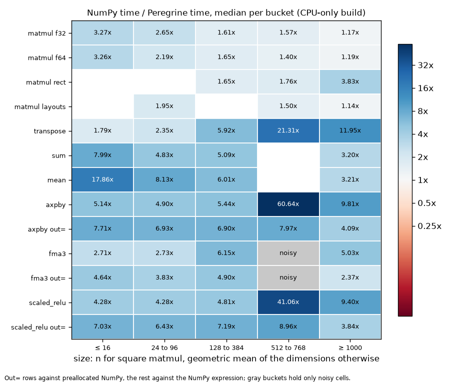
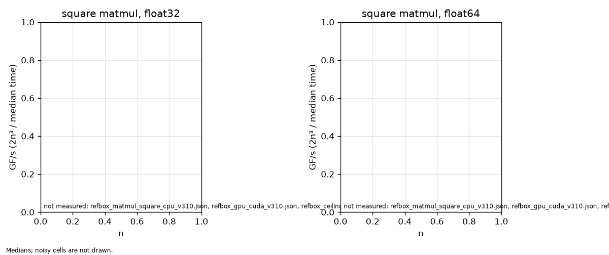

# Peregrine


Peregrine is a linear algebra library for Python. It covers a small set of NumPy
operations (the matrix product, transpose, sum, mean, and three fused
elementwise expressions) with its own AVX2 kernels, and adds an optional CUDA
backend for float32 matrix products. It reads NumPy arrays in place, returns
NumPy arrays, and holds every result to NumPy's within a written error bound,
bit for bit wherever the order of operations is the same.

Version 3.1.0. Windows (MSVC) is the primary platform; Linux builds with GCC.

## What it provides

- `matmul(a, b, *, out=None)` for float32 and float64, matching `numpy.matmul`
  including zero-sized dimensions and NaN and Inf, for operands in any memory
  layout (C or Fortran order, transposed or sliced views), read without a copy.
- `transpose(a)`, `sum(a, *, axis=None)` and `mean(a, *, axis=None)`.
- Fused elementwise operations that compute an expression in one pass:
  `axpby(x, y, *, a, b, out=None)` for `a*x + b*y`, `fma3(x, y, z, *, out=None)`
  for `x*y + z` with a single rounding, and `scaled_relu(x, *, scale, out=None)`
  for `maximum(scale*x, 0)`.
- Thread control: `set_num_threads(n)`, `get_num_threads()`, and the
  `PEREGRINE_NUM_THREADS` environment variable.
- An optional CUDA backend: device arrays (`to_device`, `from_device`,
  `__dlpack__`), device-resident matmul and fused operations, and an `"auto"`
  backend that sends a host float32 product to the GPU only when this machine's
  calibration says the GPU wins after paying for the transfers. float64 never
  goes to the GPU automatically.

The plain reference kernel stays in the library: it is the oracle the tests
check every kernel against, and the path taken on a CPU without AVX2.

## Install

Each GitHub Release carries wheels for CPython 3.12 and later (one abi3 wheel
per platform: Windows x86-64 and Linux x86-64, manylinux_2_28), a `SHA256SUMS`
file, and build attestations. The wheels are CPU-only and bundle the C++ and
OpenMP runtimes they load. Install one from its release URL:

```bash
pip install https://github.com/Abdalla-Eldoumani/peregrine/releases/download/v3.1.0/peregrine-3.1.0-cp312-abi3-win_amd64.whl
```

To check a downloaded file against its attestation:

```bash
gh attestation verify peregrine-3.1.0-cp312-abi3-win_amd64.whl --repo Abdalla-Eldoumani/peregrine
```

From source, with a C++20 compiler (MSVC from Visual Studio 2022 or later, or
GCC) and CMake 3.26 or later:

```bash
pip install .
```

The CUDA backend needs the CUDA Toolkit 12.8 and an NVIDIA driver new enough for
it; the kernels target compute capability 8.6:

```bash
pip install . --config-settings=cmake.define.PG_ENABLE_CUDA=ON
```

`pg.has_cuda()` reports whether a usable device is present at runtime. On a
CPU-only build it returns False and every operation runs on the CPU.

## Quickstart

```python
import numpy as np
import peregrine as pg

a = np.array([[1.0, 2.0], [3.0, 4.0]])
b = np.eye(2)

# Matrix product (host arrays in, host array out).
pg.matmul(a, b)

# Transpose returns an owned copy, not a view.
pg.transpose(np.array([[1.0, 2.0, 3.0], [4.0, 5.0, 6.0]]))

# Reductions: axis is keyword-only (None, 0, or 1).
pg.sum(a)            # scalar
pg.sum(a, axis=0)    # length-n vector
pg.mean(a, axis=1)   # length-m vector

# Fused elementwise ops. Array operands are positional; scalars are keyword-only.
x = np.array([[1.0, 2.0], [3.0, 4.0]])
y = np.array([[10.0, 20.0], [30.0, 40.0]])
z = np.array([[1.0, 1.0], [1.0, 1.0]])
pg.axpby(x, y, a=2.0, b=-1.0)   # a*x + b*y
pg.fma3(x, y, z)                # x*y + z, one rounding
pg.scaled_relu(x, scale=3.0)    # maximum(scale*x, 0)
```

With a CUDA build and a usable device:

```python
import numpy as np
import peregrine as pg

if pg.has_cuda():
    a = np.random.default_rng(0).standard_normal((1024, 1024)).astype(np.float32)
    b = np.random.default_rng(1).standard_normal((1024, 1024)).astype(np.float32)

    # Place operands on the device; matmul of two device arrays returns a device
    # array (no implicit transfer back).
    da = pg.to_device(a)
    db = pg.to_device(b)
    dc = pg.matmul(da, db)
    c = pg.from_device(dc)

    # Measure this machine and route host float32 products by the result.
    pg.calibrate(force=True)
    pg.set_backend("auto")
```

`set_backend` accepts `"auto"`, `"cpu"`, or `"cuda"`. `calibrate` measures a square
GEMM per size and dtype and caches the crossover the auto policy reads.

### Output memory

A large result is new memory from the operating system, and the first write to
each 4 KiB page of it costs a page fault, which for a
transpose or a fused op over a few MiB can take longer than the arithmetic.
Peregrine therefore keeps the buffers of large results you have freed (512 KiB
and up) and hands them to the next result of the same size. Results are still
ordinary NumPy-owned arrays; NumPy's own allocations and yours are untouched.
The price is memory: up to 256 MiB of freed buffers stay with the process
instead of going back to the system. Set `PEREGRINE_OUTPUT_CACHE_MB` before
importing Peregrine to change that cap, or to `0` to turn the cache off.

### Threads

Peregrine runs its kernels on a thread team sized to each call's work, so a
small call stays on one thread. The thread count comes from, in order,
`pg.set_num_threads(n)`, the `PEREGRINE_NUM_THREADS` environment variable, the
first entry of `OMP_NUM_THREADS`, and otherwise the number of physical cores
the process may run on. Results are bitwise the same for every thread count.

### Configuration

| Variable | Effect |
| --- | --- |
| `PEREGRINE_NUM_THREADS` | Thread count, unless `set_num_threads` is called. |
| `PEREGRINE_BACKEND` | Starting backend: `auto` (default), `cpu`, or `cuda`. |
| `PEREGRINE_CACHE_DIR` | Where `calibrate()` stores this machine's timings. |
| `PEREGRINE_OUTPUT_CACHE_MB` | Cap on kept result buffers (default 256; 0 turns it off). |
| `PEREGRINE_ALLOW_TF32` | Lets GPU float32 products use TF32 (off by default). |
| `PEREGRINE_DISABLE_FAST_ENTRIES` | Sends every call through the Python path (for testing). |
| `PEREGRINE_DISABLE_AVX2` | Uses the reference kernels (for testing). |

### Numerics

Peregrine is never built with fast-math options. NaN and Inf land where NumPy
puts them, results do not depend on the thread count or on operand layout, and
reductions add in a pairwise order. Where the order of operations differs from
NumPy's, results agree within a bound derived from the standard error analysis
of each operation. [docs/numerics.md](docs/numerics.md) states the contract
exactly.

## Results

Every table in this section is generated by `benchmarks/report.py` from the
result files in `benchmarks/results/`, and `python benchmarks/report.py --check`
fails when a table and its file disagree. A ratio is NumPy's median time divided
by Peregrine's on the same inputs, with both libraries limited to the same
number of threads, so a ratio above one means Peregrine is faster. Every cell
has a target, and cells that miss it are listed below with the reason. The full
matrix, with spreads and minimums for every cell, is in
[docs/benchmarks.md](docs/benchmarks.md).

### Headline

<!-- report:headline -->
Representative cells from the full matrix. Times are medians of the timed samples; both libraries ran at the thread count in the threads column. The ratio is the baseline's median time divided by Peregrine's, so above 1.00x Peregrine is faster; a percentage compares Peregrine with its own reference route. The auto rows come from the CUDA build, the rest from the CPU-only build.

| operation | dtype | shape | threads | baseline | baseline median | Peregrine median | ratio | target | status |
|---|---|---|---|---|---|---|---|---|---|
| matmul a @ b | float32 | 16x16x16 | 6 | NumPy | 1.70 us | 533 ns | 3.17x | >= 3.00x NumPy | met |
| matmul a @ b | float32 | 64x64x64 | 6 | NumPy | 9.40 us | 5.29 us | 1.78x | >= 1.50x NumPy | met |
| matmul a @ b | float32 | 256x256x256 | 6 | NumPy | 122 us | 76.0 us | 1.61x | >= 1.15x NumPy | met |
| matmul a @ b | float32 | 512x512x512 | 6 | NumPy | 813 us | 519 us | 1.57x | >= 1.05x NumPy | met |
| matmul a @ b | float32 | 2048x2048x2048 | 6 | NumPy | - | - | noisy | >= 0.97x NumPy | noisy |
| matmul a @ b | float64 | 16x16x16 | 6 | NumPy | 1.76 us | 613 ns | 2.87x | >= 3.00x NumPy | deferred |
| matmul a @ b | float64 | 64x64x64 | 6 | NumPy | 15.1 us | 6.98 us | 2.19x | >= 1.50x NumPy | met |
| matmul a @ b | float64 | 256x256x256 | 6 | NumPy | 209 us | 153 us | 1.36x | >= 1.15x NumPy | met |
| matmul a @ b | float64 | 512x512x512 | 6 | NumPy | 1.55 ms | 1.11 ms | 1.40x | >= 1.05x NumPy | met |
| matmul a @ b | float64 | 2048x2048x2048 | 6 | NumPy | 77.6 ms | 68.6 ms | 1.13x | >= 0.97x NumPy | met |
| matmul a @ b | float32 | 1x4096x4096 | 6 | NumPy | - | - | noisy | >= 1.00x NumPy | noisy |
| matmul a @ b | float32 | 4096x64x4096 | 6 | NumPy | 19.2 ms | 4.89 ms | 3.92x | >= 1.00x NumPy | met |
| matmul a @ b | float64 | 1000x333x750 | 6 | NumPy | 2.90 ms | 2.06 ms | 1.41x | >= 1.00x NumPy | met |
| matmul a.T @ b | float32 | 512x512x512 | 6 | NumPy | 817 us | 524 us | 1.56x | >= 1.05x NumPy | met |
| matmul a.T @ b | float32 | 512x512x512 | 6 | own C-layout time | 506 us | 524 us | +3.5% | within 10% of own C-layout time | met |
| matmul a @ b.T | float32 | 512x512x512 | 6 | NumPy | - | - | noisy | >= 1.05x NumPy | noisy |
| matmul a @ b.T | float32 | 512x512x512 | 6 | own C-layout time | - | - | noisy | within 10% of own C-layout time | noisy |
| matmul a @ b, both F-order | float32 | 512x512x512 | 6 | NumPy | - | - | noisy | >= 1.05x NumPy | noisy |
| matmul a @ b, both F-order | float32 | 512x512x512 | 6 | own C-layout time | - | - | noisy | within 10% of own C-layout time | noisy |
| transpose | float32 | 64x64 | 6 | NumPy | 2.57 us | 1.12 us | 2.29x | >= 2.00x NumPy | met |
| transpose | float32 | 2048x2048 | 6 | NumPy | 43.7 ms | 1.22 ms | 35.80x | >= 4.00x NumPy | met |
| transpose | float64 | 1000x3000 | 6 | NumPy | 9.61 ms | 1.84 ms | 5.28x | >= 4.00x NumPy | met |
| sum, axis=None | float32 | 64x64 | 6 | NumPy | 2.64 us | 684 ns | 3.86x | >= 3.00x NumPy | met |
| sum, axis=None | float64 | 4096x4096 | 6 | NumPy | 23.2 ms | 6.85 ms | 3.39x | >= 1.50x NumPy | met |
| mean, axis=0 | float32 | 1024x1024 | 6 | NumPy | 103 us | 24.9 us | 4.14x | >= 1.50x NumPy | met |
| mean, axis=1 | float64 | 1000000x16 | 6 | NumPy | 15.3 ms | 5.16 ms | 2.97x | >= 1.50x NumPy | met |
| axpby, new output | float32 | 1024x1024 | 6 | NumPy | - | - | noisy | >= 2.00x NumPy | noisy |
| axpby, out= | float32 | 1024x1024 | 6 | NumPy, preallocated | - | - | noisy | >= 2.00x NumPy, preallocated | noisy |
| fma3, new output | float32 | 1024x1024 | 6 | NumPy | 2.31 ms | 228 us | 10.13x | >= 2.00x NumPy | met |
| fma3, out= | float32 | 1024x1024 | 6 | NumPy, preallocated | 647 us | 223 us | 2.90x | >= 2.00x NumPy, preallocated | met |
| scaled_relu, new output | float32 | 1024x1024 | 6 | NumPy | 1.98 ms | 86.6 us | 22.91x | >= 2.00x NumPy | met |
| scaled_relu, out= | float32 | 1024x1024 | 6 | NumPy, preallocated | 461 us | 41.6 us | 11.08x | >= 2.00x NumPy, preallocated | met |
| matmul a @ b, auto route | float32 | 2048x2048x2048 | 6 | faster forced route | - | - | noisy | within 5% of the faster forced route | noisy |
| matmul a @ b, auto route | float32 | 2048x2048x2048 | 6 | NumPy | - | - | noisy | >= 5.00x NumPy | noisy |
| matmul a @ b, auto route | float32 | 4096x4096x4096 | 6 | faster forced route | - | - | noisy | within 5% of the faster forced route | noisy |
| matmul a @ b, auto route | float32 | 4096x4096x4096 | 6 | NumPy | - | - | noisy | >= 5.00x NumPy | noisy |
<!-- /report:headline -->

### The whole matrix at a glance

Each square is the median ratio over the cells of one operation in one size
range, on a log color scale centered at parity. Gray squares are cells the
protocol closed as noisy, which carry no number.



### Matrix multiply throughput

Square matmul throughput against size for Peregrine and NumPy on the CPU, and
for Peregrine's device-resident GPU path, with the CPU's measured FMA peak drawn
as a ceiling.



### Losses and closures

<!-- report:losses -->
**Below 1.00x.** Every measured ratio below one: the baseline's median time divided by Peregrine's, both libraries at the thread count in the cell id, with the reason.

No measured cell is below 1.00x against any baseline.

**Closed below target.** Cells that miss their target and are closed at a measured ceiling or deferred; every number is computed from the results files.

| cell | results file | closure | evidence | reason |
|---|---|---|---|---|
| `matmul/float32/1x1x1/c/-/t6` | `refbox_matmul_square_cpu_v310.json` | deferred | 2.91x against NumPy (target >= 3.00x NumPy) | the call is bound by fixed costs, the Python wrapper, the argument checks, and NumPy's own allocation of the result; three approaches were measured (the native fast entry with the GIL held for small products, a single-block mode and vector row packing in the small kernel, and a native public entry, which the project's rule for promoting a function to native code did not allow) |
| `matmul/float64/1x1x1/c/-/t6` | `refbox_matmul_square_cpu_v310.json` | deferred | 2.97x against NumPy (target >= 3.00x NumPy) | the call is bound by fixed costs, the Python wrapper, the argument checks, and NumPy's own allocation of the result; three approaches were measured (the native fast entry with the GIL held for small products, a single-block mode and vector row packing in the small kernel, and a native public entry, which the project's rule for promoting a function to native code did not allow) |
| `matmul/float64/12x12x12/c/-/t6` | `refbox_matmul_square_cpu_v310.json` | deferred | 2.96x against NumPy (target >= 3.00x NumPy) | the call is bound by fixed costs, the Python wrapper, the argument checks, and NumPy's own allocation of the result; three approaches were measured (the native fast entry with the GIL held for small products, a single-block mode and vector row packing in the small kernel, and a native public entry, which the project's rule for promoting a function to native code did not allow) |
| `matmul/float64/16x16x16/c/-/t6` | `refbox_matmul_square_cpu_v310.json` | deferred | 2.87x against NumPy (target >= 3.00x NumPy) | the call is bound by fixed costs, the Python wrapper, the argument checks, and NumPy's own allocation of the result; three approaches were measured (the native fast entry with the GIL held for small products, a single-block mode and vector row packing in the small kernel, and a native public entry, which the project's rule for promoting a function to native code did not allow) |
| `matmul/float64/64x64x64/at_b/-/t6` | `refbox_matmul_layout_cpu_v310.json` | deferred | +18.7% against own C-layout time (target within 10% of own C-layout time) | NumPy places these arrays at any 16-byte offset in a cache line, and that placement alone moves the C-order reference cell between runs; three approaches were measured (F-order packing, reading a crowded column-major A in place with prefetch, and two-thread splits by column panels with shared or per-member B packing) |
| `transpose/float32/8x8/c/-/t6` | `refbox_transpose_cpu_v310.json` | deferred | 1.79x against NumPy (target >= 2.00x NumPy) | the call is bound by the Python wrapper and the result's allocation; three approaches were measured (lane-load tiles without threading overhead at one thread, a separate small-array path, and a native public entry, which the promotion rule did not allow) |
| `transpose/float64/8x8/c/-/t6` | `refbox_transpose_cpu_v310.json` | deferred | 1.79x against NumPy (target >= 2.00x NumPy) | the call is bound by the Python wrapper and the result's allocation; three approaches were measured (lane-load tiles without threading overhead at one thread, a separate small-array path, and a native public entry, which the promotion rule did not allow) |
| `fma3/float32/8x8/c/alloc/t6` | `refbox_fused_cpu_v310.json` | deferred | 2.74x against NumPy (target >= 3.00x NumPy) | against the expression that also allocates, the result's own allocation and the call's fixed cost take a large share of the time, and at 32x32 four float64 arrays fill the L1 cache; three approaches were measured (a one-thread path without a parallel region, a four-vector loop with a 4K-aliasing direction, and a native public entry, which the promotion rule did not allow) |
| `fma3/float32/32x32/c/alloc/t6` | `refbox_fused_cpu_v310.json` | deferred | 2.92x against NumPy (target >= 3.00x NumPy) | against the expression that also allocates, the result's own allocation and the call's fixed cost take a large share of the time, and at 32x32 four float64 arrays fill the L1 cache; three approaches were measured (a one-thread path without a parallel region, a four-vector loop with a 4K-aliasing direction, and a native public entry, which the promotion rule did not allow) |
| `fma3/float64/8x8/c/alloc/t6` | `refbox_fused_cpu_v310.json` | deferred | 2.68x against NumPy (target >= 3.00x NumPy) | against the expression that also allocates, the result's own allocation and the call's fixed cost take a large share of the time, and at 32x32 four float64 arrays fill the L1 cache; three approaches were measured (a one-thread path without a parallel region, a four-vector loop with a 4K-aliasing direction, and a native public entry, which the promotion rule did not allow) |
| `fma3/float64/32x32/c/alloc/t6` | `refbox_fused_cpu_v310.json` | deferred | 2.55x against NumPy (target >= 3.00x NumPy) | against the expression that also allocates, the result's own allocation and the call's fixed cost take a large share of the time, and at 32x32 four float64 arrays fill the L1 cache; three approaches were measured (a one-thread path without a parallel region, a four-vector loop with a 4K-aliasing direction, and a native public entry, which the promotion rule did not allow) |
| `fma3/float32/8x8/c/alloc/t6` | `refbox_overhead_cpu_v310.json` | deferred | 2.78x against NumPy (target >= 3.00x NumPy) | against the expression that also allocates, the result's own allocation and the call's fixed cost take a large share of the time, and at 32x32 four float64 arrays fill the L1 cache; three approaches were measured (a one-thread path without a parallel region, a four-vector loop with a 4K-aliasing direction, and a native public entry, which the promotion rule did not allow) |
| `fma3/float64/8x8/c/alloc/t6` | `refbox_overhead_cpu_v310.json` | deferred | 2.73x against NumPy (target >= 3.00x NumPy) | against the expression that also allocates, the result's own allocation and the call's fixed cost take a large share of the time, and at 32x32 four float64 arrays fill the L1 cache; three approaches were measured (a one-thread path without a parallel region, a four-vector loop with a 4K-aliasing direction, and a native public entry, which the promotion rule did not allow) |
| `transpose/float32/8x8/c/-/t6` | `refbox_overhead_cpu_v310.json` | deferred | 1.79x against NumPy (target >= 2.00x NumPy) | the call is bound by the Python wrapper and the result's allocation; three approaches were measured (lane-load tiles without threading overhead at one thread, a separate small-array path, and a native public entry, which the promotion rule did not allow) |
| `transpose/float64/8x8/c/-/t6` | `refbox_overhead_cpu_v310.json` | deferred | 1.82x against NumPy (target >= 2.00x NumPy) | the call is bound by the Python wrapper and the result's allocation; three approaches were measured (lane-load tiles without threading overhead at one thread, a separate small-array path, and a native public entry, which the promotion rule did not allow) |
| `scaling/float64/2048x2048x2048/c/-/t1-t6` | `refbox_gemm_1t_cpu_v310.json`, `refbox_matmul_square_cpu_v310.json` | deferred | Peregrine 4.40x from 1 to 6 threads, OpenBLAS 4.08x, measured FMA peak ratio 5.44x | per-thread timers show the six-thread compute is bound by the all-core clock under the laptop's power limit; three approaches to the remaining synchronization cost were measured (point-to-point step counters with two B buffers, prefetch of the next B panel, and team-sized row blocks) |

**Below target, not closed.**

None.

**CUDA build spot check.** The CUDA build runs the same CPU code; its host cells are compared with the CPU-only build's, and these differ by more than 5 percent. The runs were hours apart, and the cause was not isolated.

- `axpby/float64/8x8/c/alloc/t6` in `refbox_overhead_cuda_v310.json` (5.9% slower than the CPU-only build)
- `matmul/float64/16x16x16/c/-/t6` in `refbox_overhead_cuda_v310.json` (9.1% slower than the CPU-only build)

**Noisy.** These cells stayed above the CV limit on every attempt, including the fresh-process retry, so the protocol publishes no number for them.

- matmul, square, CPU-only build: `matmul/float32/250x250x250/c/-/t6/s0`, `matmul/float32/640x640x640/c/-/t6/s0`, `matmul/float32/750x750x750/c/-/t6/s0`, `matmul/float32/1500x1500x1500/c/-/t6/s0`, `matmul/float32/2048x2048x2048/c/-/t6/s0`, `matmul/float32/4096x4096x4096/c/-/t6/s0`, `matmul/float64/250x250x250/c/-/t6/s0`, `matmul/float64/256x256x256/c/-/t6/s0`, `matmul/float64/333x333x333/c/-/t6/s0`, `matmul/float64/384x384x384/c/-/t6/s0`, `matmul/float64/640x640x640/c/-/t6/s0`, `matmul/float64/750x750x750/c/-/t6/s0`, `matmul/float64/1000x1000x1000/c/-/t6/s0`, `matmul/float64/1500x1500x1500/c/-/t6/s0`, `matmul/float64/2048x2048x2048/c/-/t6/s0`, `matmul/float64/3000x3000x3000/c/-/t6/s0`, `matmul/float64/4096x4096x4096/c/-/t6/s0`, `matmul/float32/256x256x256/c/-/t6/s1`, `matmul/float32/512x512x512/c/-/t6/s1`, `matmul/float32/2048x2048x2048/c/-/t6/s1`, `matmul/float32/2048x2048x2048/c/-/t6/s2`, `matmul/float64/256x256x256/c/-/t6/s2`, `matmul/float64/512x512x512/c/-/t6/s1`, `matmul/float64/512x512x512/c/-/t6/s2`
- matmul, rectangular, CPU-only build: `matmul/float64/1x4096x4096/c/-/t6/s0`, `matmul/float64/4096x4096x1/c/-/t6/s0`, `matmul/float64/4x4096x4096/c/-/t6/s0`, `matmul/float64/4096x256x256/c/-/t6/s0`, `matmul/float64/256x4096x256/c/-/t6/s0`, `matmul/float64/256x256x4096/c/-/t6/s0`, `matmul/float32/1x4096x4096/c/-/t6/s0`, `matmul/float32/4096x256x256/c/-/t6/s0`, `matmul/float32/256x4096x256/c/-/t6/s0`, `matmul/float32/256x256x4096/c/-/t6/s0`, `matmul/float32/1000x333x750/c/-/t6/s0`, `matmul/float32/1x4096x4096/c/-/t6/s1`, `matmul/float32/1x4096x4096/c/-/t6/s2`, `matmul/float32/4096x64x4096/c/-/t6/s2`
- matmul, operand layouts, CPU-only build: `matmul/float64/1000x333x750/a_bt/-/t6/s0`, `matmul/float64/512x512x512/ff/-/t6/s0`, `matmul/float64/1000x333x750/ff/-/t6/s0`, `matmul/float64/4096x256x256/ff/-/t6/s0`, `matmul/float64/512x512x512/c/-/t6/s0`, `matmul/float64/1000x333x750/c/-/t6/s0`, `matmul/float64/4096x256x256/c/-/t6/s0`, `matmul/float32/1000x333x750/c/-/t6/s0`, `matmul/float32/4096x256x256/c/-/t6/s0`, `matmul/float32/512x512x512/ff/-/t6/s0`, `matmul/float32/2048x2048x2048/ff/-/t6/s0`, `matmul/float32/1000x333x750/ff/-/t6/s0`, `matmul/float64/512x512x512/at_b/-/t6/s0`, `matmul/float64/2048x2048x2048/at_b/-/t6/s0`, `matmul/float64/1000x333x750/at_b/-/t6/s0`, `matmul/float64/4096x256x256/at_b/-/t6/s0`, `matmul/float32/512x512x512/a_bt/-/t6/s0`, `matmul/float32/2048x2048x2048/a_bt/-/t6/s0`, `matmul/float32/1000x333x750/a_bt/-/t6/s0`, `matmul/float32/4096x256x256/a_bt/-/t6/s0`, `matmul/float32/512x512x512/at_b/-/t6/s0`, `matmul/float32/2048x2048x2048/at_b/-/t6/s0`, `matmul/float32/1000x333x750/at_b/-/t6/s0`, `matmul/float32/4096x256x256/at_b/-/t6/s0`, `matmul/float32/512x512x512/a_bt/-/t6/s1`, `matmul/float32/512x512x512/a_bt/-/t6/s2`, `matmul/float32/512x512x512/c/-/t6/s1`, `matmul/float32/512x512x512/at_b/-/t6/s2`, `matmul/float32/512x512x512/ff/-/t6/s1`, `matmul/float32/512x512x512/ff/-/t6/s2`
- transpose, CPU-only build: `transpose/float64/256x256/c/-/t6/s0`, `transpose/float64/512x512/c/-/t6/s0`, `transpose/float64/4096x4096/c/-/t6/s0`, `transpose/float32/256x256/c/-/t6/s0`, `transpose/float32/4096x4096/c/-/t6/s0`, `transpose/float32/64x64/c/-/t6/s1`, `transpose/float32/2048x2048/c/-/t6/s1`, `transpose/float32/2048x2048/c/-/t6/s2`
- sum and mean, CPU-only build: `sum/float64/4096x4096/c/axis=None/t6/s0`, `sum/float64/16x1000000/c/axis=None/t6/s0`, `sum/float64/1000000x16/c/axis=None/t6/s0`, `mean/float64/1024x1024/c/axis=0/t6/s0`, `mean/float64/4096x4096/c/axis=1/t6/s0`, `mean/float64/16x1000000/c/axis=1/t6/s0`, `sum/float32/1024x1024/c/axis=None/t6/s0`, `mean/float64/1024x1024/c/axis=None/t6/s0`, `mean/float64/4096x4096/c/axis=None/t6/s0`, `mean/float64/16x1000000/c/axis=None/t6/s0`, `mean/float64/1000000x16/c/axis=None/t6/s0`, `mean/float32/1024x1024/c/axis=1/t6/s0`, `sum/float32/4096x4096/c/axis=1/t6/s0`, `sum/float64/256x256/c/axis=1/t6/s0`, `sum/float64/1024x1024/c/axis=1/t6/s0`, `sum/float64/4096x4096/c/axis=1/t6/s0`, `sum/float64/16x1000000/c/axis=1/t6/s0`, `sum/float64/1024x1024/c/axis=0/t6/s0`, `mean/float32/1024x1024/c/axis=0/t6/s0`, `sum/float32/1024x1024/c/axis=0/t6/s0`, `sum/float64/4096x4096/c/axis=None/t6/s2`
- fused elementwise ops, CPU-only build: `scaled_relu/float64/128x128/c/alloc/t6/s0`, `scaled_relu/float64/1024x1024/c/alloc/t6/s0`, `scaled_relu/float64/5793x5793/c/alloc/t6/s0`, `axpby/float64/512x512/c/out/t6/s0`, `fma3/float64/512x512/c/alloc/t6/s0`, `axpby/float32/1024x1024/c/out/t6/s0`, `fma3/float32/512x512/c/out/t6/s0`, `scaled_relu/float32/128x128/c/out/t6/s0`, `scaled_relu/float32/512x512/c/out/t6/s0`, `axpby/float64/128x128/c/alloc/t6/s0`, `axpby/float64/5793x5793/c/alloc/t6/s0`, `scaled_relu/float32/1024x1024/c/alloc/t6/s0`, `axpby/float32/512x512/c/alloc/t6/s0`, `axpby/float32/1024x1024/c/alloc/t6/s0`, `fma3/float32/128x128/c/alloc/t6/s0`, `fma3/float32/512x512/c/alloc/t6/s0`, `fma3/float32/1024x1024/c/alloc/t6/s0`, `fma3/float64/512x512/c/out/t6/s0`, `scaled_relu/float32/1024x1024/c/alloc/t6/s1`, `axpby/float32/1024x1024/c/out/t6/s1`, `axpby/float32/1024x1024/c/out/t6/s2`, `axpby/float32/1024x1024/c/alloc/t6/s1`, `axpby/float32/1024x1024/c/alloc/t6/s2`, `scaled_relu/float32/1024x1024/c/out/t6/s1`, `scaled_relu/float32/1024x1024/c/out/t6/s2`, `fma3/float32/1024x1024/c/out/t6/s1`, `fma3/float32/1024x1024/c/out/t6/s2`, `fma3/float32/1024x1024/c/alloc/t6/s1`
- GPU, CUDA build: `from_device/float32/4096x8192/c/-/t6/s0`, `gpu_matmul/float64/256x256x256/c/device/t6/s0`, `gpu_matmul/float64/512x512x512/c/device/t6/s0`, `gpu_matmul/float64/1024x1024x1024/c/device/t6/s0`, `gpu_matmul/float64/2048x2048x2048/c/device/t6/s0`, `gpu_matmul/float64/4096x4096x4096/c/device/t6/s0`, `gpu_matmul/float32/2048x2048x2048/c/device/t6/s0`, `gpu_matmul/float32/4096x4096x4096/c/device/t6/s0`, `matmul/float32/256x256x256/c/auto/t6/s0`, `matmul/float32/512x512x512/c/auto/t6/s0`, `matmul/float32/1024x1024x1024/c/auto/t6/s0`, `matmul/float32/2048x2048x2048/c/auto/t6/s0`, `matmul/float32/4096x4096x4096/c/auto/t6/s0`, `matmul/float32/1x4096x4096/c/auto/t6/s0`, `matmul/float32/4096x64x4096/c/auto/t6/s0`, `matmul/float32/2048x2048x2048/c/auto/t6/s1`, `matmul/float32/2048x2048x2048/c/auto/t6/s2`, `matmul/float32/4096x4096x4096/c/auto/t6/s1`, `matmul/float32/4096x4096x4096/c/auto/t6/s2`
- per-call overhead, CUDA build: `matmul/float32/256x256x256/c/-/t6/s0`, `matmul/float32/2048x2048x2048/c/-/t6/s0`
<!-- /report:losses -->

### v3.0.0 to v3.1.0

<!-- report:compare -->
Peregrine's median time in the v3.0.0 and v3.1.0 runs of the quick subset, same harness and machine, with NumPy's median in each run as a check that the machine state matched. The speedup is the v3.0.0 time divided by the v3.1.0 time; both libraries ran at the thread count in the threads column. A selection, plus every cell that got slower; the full list is in docs/benchmarks.md.

| operation | dtype | shape | threads | NumPy, v3.0.0 run | NumPy, v3.1.0 run | Peregrine v3.0.0 | Peregrine v3.1.0 | speedup |
|---|---|---|---|---|---|---|---|---|
| axpby, new output | float32 | 2896x2896 | 6 | 30.2 ms | 27.1 ms | 7.88 ms | 2.74 ms | 2.87x |
| matmul a @ b | float32 | 64x64x64 | 6 | 9.45 us | 9.13 us | 119 us | 5.21 us | 22.81x |
| matmul a @ b | float32 | 1x4096x4096 | 6 | noisy | noisy | noisy | noisy | - |
| matmul a.T @ b | float32 | 512x512x512 | 6 | noisy | 837 us | noisy | 555 us | - |
| matmul a @ b | float32 | 2048x2048x2048 | 6 | 36.6 ms | 36.5 ms | 57.7 ms | 32.8 ms | 1.76x |
| matmul a @ b | float64 | 64x64x64 | 6 | 15.2 us | 15.1 us | 121 us | 7.56 us | 15.99x |
| matmul a @ b | float64 | 2048x2048x2048 | 6 | 79.8 ms | noisy | 135 ms | noisy | - |
| sum, axis=None | float64 | 4096x4096 | 6 | 24.1 ms | 23.4 ms | 23.7 ms | 7.10 ms | 3.33x |
| transpose | float32 | 2048x2048 | 6 | noisy | 47.9 ms | noisy | 1.24 ms | - |
| matmul a @ b, auto route | float32 | 2048x2048x2048 | 6 | noisy | noisy | noisy | noisy | - |
<!-- /report:compare -->

## Method

Both libraries run in one process on the same ndarray inputs, built once per
seed outside the timed region. Samples interleave in short blocks of one library
then the other, mirrored so neither always goes first, and each sample is a
batch of calls through the same timing loop for both. After every switch the
incoming library runs untimed for a short rewarm. Every sample's output is
checked bit for bit against the first output, which is itself checked against
the test suite's oracle. A cell whose spread exceeds the coefficient-of-variation
limit is retried, then run once more in a fresh process, and if it is still
noisy it is reported as noisy with no number. The process runs at high priority
on one logical CPU per physical core, and samples taken while the processor
clock sits outside a band set from the ceiling tool are discarded. The exact
settings are below; the full method and the commands to reproduce every file
are in [docs/benchmarks.md](docs/benchmarks.md).

<!-- report:environment -->
Each results file and the run that wrote it:

| results file | build | Peregrine | commit | date | priority |
|---|---|---|---|---|---|
| `refbox_matmul_square_cpu_v310.json` | CPU-only | 3.1.0 | 4e21f991b096 | 2026-10-21T14:06 | high |
| `refbox_matmul_rect_cpu_v310.json` | CPU-only | 3.1.0 | 4e21f991b096 | 2026-10-21T16:43 | high |
| `refbox_matmul_layout_cpu_v310.json` | CPU-only | 3.1.0 | 4e21f991b096 | 2026-10-21T17:48 | high |
| `refbox_transpose_cpu_v310.json` | CPU-only | 3.1.0 | 4e21f991b096 | 2026-10-21T20:27 | high |
| `refbox_reduce_cpu_v310.json` | CPU-only | 3.1.0 | 4e21f991b096 | 2026-10-21T22:32 | high |
| `refbox_fused_cpu_v310.json` | CPU-only | 3.1.0 | 4e21f991b096 | 2026-10-22T01:56 | high |
| `refbox_overhead_cpu_v310.json` | CPU-only | 3.1.0 | 4e21f991b096 | 2026-10-22T10:52 | high |
| `refbox_gemm_1t_cpu_v310.json` | CPU-only | 3.1.0 | 4e21f991b096 | 2026-10-22T10:41 | high |
| `refbox_gpu_cuda_v310.json` | CUDA | 3.1.0 | 4e21f991b096 | 2026-10-21T03:01 | high |
| `refbox_overhead_cuda_v310.json` | CUDA | 3.1.0 | 4e21f991b096 | 2026-10-21T06:06 | high |
| `refbox_quick_cpu_v300.json` | CPU-only | 3.0.0 | unknown | 2026-10-21T08:10 | high |
| `refbox_quick_cpu_v310.json` | CPU-only | 3.1.0 | 4e21f991b096 | 2026-10-22T11:37 | high |
| `refbox_quick_cuda_v300.json` | CUDA | 3.0.0 | unknown | 2026-10-21T10:49 | high |
| `refbox_quick_cuda_v310.json` | CUDA | 3.1.0 | 4e21f991b096 | 2026-10-21T06:54 | high |

Measurement conditions recorded in the manifests of the matrix files (one value means every file agrees):

| condition | value |
|---|---|
| Peregrine threads | 6, 1 |
| OpenBLAS threads | 6 |
| OMP_NUM_THREADS at start | 6 |
| process priority | high |
| affinity mask (one logical CPU per core) | 0x555 |
| CPU | Intel(R) Core(TM) i7-10750H CPU @ 2.60GHz |
| OS | Windows-10-10.0.19045-SP0 |
| power plan | Ultimate Performance |
| Python | 3.12.4 |
| NumPy | 2.5.4 |
| OpenBLAS | 0.3.34.106.0 (Haswell kernels) |
| compiler | MSVC 19.42.34436.0 |
| compiler flags | `/DWIN32 /D_WINDOWS /EHsc /O2 /Ob2 /DNDEBUG /bigobj /MP /O2 /permissive- /W4 SHELL:-openmp` |
| OpenMP runtime | vcomp140.dll |
| GPU and driver (CUDA build) | NVIDIA GeForce RTX 3060 Laptop GPU, driver 617.14 |
| samples per contender | 30 |
| warmup samples | 5 |
| samples per ABBA block | 5 |
| batch target per sample | 100 ms |
| rewarm after a switch | 200 ms |
| rewarm after a switch, GPU contenders | 3.00 s |
| idle gap at a switch | 300 ms |
| CV limit | 5% |
| attempts before the fresh-process retry | 3 |
| clock-discard band | 42.0 to 200.0 percent processor performance |
<!-- /report:environment -->

## Hardware

The ceilings below come from a small measurement tool in `tools/ceilings`, run
on the same machine as the benchmarks.

<!-- report:hardware -->
| component | value |
|---|---|
| CPU | Intel(R) Core(TM) i7-10750H CPU @ 2.60GHz, 6 cores, 12 logical processors |
| GPU | NVIDIA GeForce RTX 3060 Laptop GPU, driver 617.14, CUDA runtime 12.8 |

FMA peak in GF/s, measured by the ceiling tool at 1 and 6 threads (one per core):

| dtype | 1 thread | 6 threads |
|---|---|---|
| float32 | 134.5 GF/s | 733.6 GF/s |
| float64 | 67.3 GF/s | 365.9 GF/s |

Memory bandwidth in GB/s, median of 10 trials over a 256 MiB float64 array, counting the bytes each kernel reads and writes:

| kernel | stores | 1 thread | 6 threads |
|---|---|---|---|
| read | none | 20.1 GB/s | 27.1 GB/s |
| write | regular | 13.5 GB/s | 17.0 GB/s |
| write | nontemporal | 40.5 GB/s | 42.1 GB/s |
| copy | regular | 18.6 GB/s | 18.4 GB/s |
| copy | nontemporal | 25.7 GB/s | 23.6 GB/s |
| triad | regular | 21.0 GB/s | 17.2 GB/s |
| triad | nontemporal | 27.0 GB/s | 21.3 GB/s |

PCIe to the NVIDIA GeForce RTX 3060 Laptop GPU, pinned host memory, median of 20 transfers of 256 MiB timed with CUDA events:

| direction | bandwidth | latency |
|---|---|---|
| H2D | 12.5 GB/s | 8.22 us |
| D2H | 12.6 GB/s | 8.46 us |
<!-- /report:hardware -->

## Development

```bash
pip install -e ".[test]"
python -m pytest tests -q
```

`PEREGRINE_DISABLE_FAST_ENTRIES=1` runs the suite through the Python path and
`PEREGRINE_DISABLE_AVX2=1` through the reference kernels; CI runs both, plus GCC
on Linux and a build under AddressSanitizer and UndefinedBehaviorSanitizer.
[docs/architecture.md](docs/architecture.md) describes how the pieces fit, and
[docs/benchmarks.md](docs/benchmarks.md) how the numbers above are measured and
how to reproduce them.

## License

MIT; see LICENSE. The wheels include third-party code and runtimes listed in
THIRD_PARTY_NOTICES.md.
