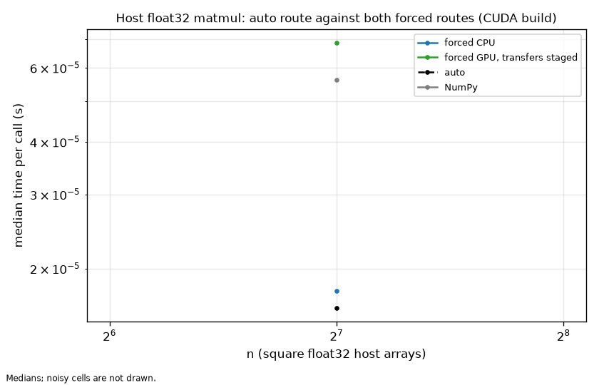

# Benchmarks

This page holds the full measurement matrix behind the README's results, how it
was measured, and how to reproduce it. Every table between the `report` markers
is generated by `benchmarks/report.py` from the files in `benchmarks/results/`;
none is typed by hand.

## Method

A cell is one operation at one dtype, shape, operand layout, variant, thread
count and seed. Its inputs are built once from a seeded generator, outside the
timed region, and the same ndarray objects go to every contender: Peregrine,
NumPy, and for the fused operations a second NumPy contender that writes into
preallocated buffers. The fused cells use strictly positive operands, the same
distribution the test suite uses, so the accuracy check stays meaningful.

Samples interleave in ABBA blocks: a few samples of one library, then the other,
then the order reversed, with the starting library chosen at random per cell.
Each sample is a batch of calls sized to a fixed target duration and run through
the same timing loop for both libraries, so a cheap call is timed as an average
over many calls rather than at the resolution of the clock. At every switch the
process idles for a gap longer than either library's idle worker threads spin,
then the incoming library runs untimed for a rewarm before its samples count.
Contenders that drive the GPU rewarm for longer, because this laptop's GPU drops
out of its fastest power state within seconds of idling; the GPU numbers are
steady state.

Every sample's output is checked bit for bit against the cell's first output,
and that first output is checked against the test suite's oracle, so a fast
wrong answer can never be recorded. A cell whose coefficient of variation is
above the limit on either side is retried after a cooldown, then measured once
more in a fresh process after a longer cooldown. If it is still above the limit
it is closed as noisy: its raw samples stay in the JSON, and the tables list it
as noisy with no number.

The process runs at high priority, confined to one logical CPU per physical
core, and both libraries run at the same thread count: the headline cells at six
threads on each side, and a single-thread diagnostic at one. Samples taken while
the processor's performance counter sits below a floor set from the ceiling
tool's sustained all-core reading, or above its single-core reading, are
discarded and taken again. The tables quote the median, with the interquartile
range and the minimum beside it.

The targets are the ones the project set before measuring. A cell either meets
its target, is closed at a measured hardware ceiling (Peregrine at 90 percent or
more of the bound and at least 0.97 times NumPy's speed, both numbers cited), is deferred
after three measured approaches, or is closed as noisy. Closed and noisy cells
never count as met.

## Conditions

<!-- report:environment -->
Not measured: `benchmarks/results/refbox_matmul_square_cpu_v310.json` is absent.
Not measured: `benchmarks/results/refbox_matmul_rect_cpu_v310.json` is absent.
Not measured: `benchmarks/results/refbox_matmul_layout_cpu_v310.json` is absent.
Not measured: `benchmarks/results/refbox_transpose_cpu_v310.json` is absent.
Not measured: `benchmarks/results/refbox_reduce_cpu_v310.json` is absent.
Not measured: `benchmarks/results/refbox_fused_cpu_v310.json` is absent.
Not measured: `benchmarks/results/refbox_overhead_cpu_v310.json` is absent.
Not measured: `benchmarks/results/refbox_gemm_1t_cpu_v310.json` is absent.
Not measured: `benchmarks/results/refbox_gpu_cuda_v310.json` is absent.
Not measured: `benchmarks/results/refbox_overhead_cuda_v310.json` is absent.
Not measured: `benchmarks/results/refbox_quick_cpu_v300.json` is absent.
Not measured: `benchmarks/results/refbox_quick_cpu_v310.json` is absent.
Not measured: `benchmarks/results/refbox_quick_cuda_v300.json` is absent.
Not measured: `benchmarks/results/refbox_quick_cuda_v310.json` is absent.
<!-- /report:environment -->

## Reproducing

Build Peregrine in a CPU-only environment, set the clock band from the ceiling
tool's readings, and run one group per command. Each command writes the file
the tables read:

```bash
pip install -e .
export OMP_NUM_THREADS=6
for g in matmul-square matmul-rect matmul-layout transpose reduce fused overhead gemm-1t; do
    python benchmarks/bench_suite.py --group $g --priority high \
        --clock-floor FLOOR --clock-ceiling CEILING \
        --out benchmarks/results/refbox_${g//-/_}_cpu_v310.json
done
```

The GPU cells and the CUDA build's per-call overhead run on the CUDA build:

```bash
pip install -e . --config-settings=cmake.define.PG_ENABLE_CUDA=ON
for g in gpu overhead; do
    python benchmarks/bench_suite.py --group $g --priority high \
        --clock-floor FLOOR --clock-ceiling CEILING \
        --out benchmarks/results/refbox_${g}_cuda_v310.json
done
```

The quick subset runs on both versions with the same harness: with v3.1.0
installed to `refbox_quick_cpu_v310.json` and `refbox_quick_cuda_v310.json`,
and with the v3.0.0 wheel installed to the `_v300` names. v3.0.0 has no thread
setter, so its runs depend on `OMP_NUM_THREADS=6` being set before the process
starts.

```bash
python benchmarks/bench_suite.py --group quick --priority high \
    --clock-floor FLOOR --clock-ceiling CEILING \
    --out benchmarks/results/refbox_quick_cpu_v310.json
```

The hardware ceilings come from a development tool that is never part of a
wheel:

```bash
cmake -S tools/ceilings -B build/ceilings -DPG_CEILINGS_CUDA=ON
cmake --build build/ceilings --config Release
build/ceilings/Release/pg_ceilings.exe --all-threads --out benchmarks/results/refbox_ceilings.json
```

Then regenerate the tables in this page and the README, and the charts:

```bash
python benchmarks/report.py --write
python benchmarks/plots.py
```

`python benchmarks/report.py --check` exits with status 1 when any table no
longer matches its file.

## v3.0.0 to v3.1.0

<!-- report:compare_full -->
Not measured: `benchmarks/results/refbox_quick_cpu_v300.json` is absent.

Not measured: `benchmarks/results/refbox_quick_cpu_v310.json` is absent.

Not measured: `benchmarks/results/refbox_quick_cuda_v300.json` is absent.

Not measured: `benchmarks/results/refbox_quick_cuda_v310.json` is absent.
<!-- /report:compare_full -->

## Full matrix

### matmul, square

<!-- report:matrix_matmul_square_cpu -->
Not measured: `benchmarks/results/refbox_matmul_square_cpu_v310.json` is absent.
<!-- /report:matrix_matmul_square_cpu -->

### matmul, rectangular and skinny

<!-- report:matrix_matmul_rect_cpu -->
Not measured: `benchmarks/results/refbox_matmul_rect_cpu_v310.json` is absent.
<!-- /report:matrix_matmul_rect_cpu -->

### matmul, operand layouts

A transposed or F-contiguous operand meets its target when it meets the
C-contiguous target for its shape and stays within 10 percent of Peregrine's
own C-contiguous time for that shape.

<!-- report:matrix_matmul_layout_cpu -->
Not measured: `benchmarks/results/refbox_matmul_layout_cpu_v310.json` is absent.
<!-- /report:matrix_matmul_layout_cpu -->

### transpose

<!-- report:matrix_transpose_cpu -->
Not measured: `benchmarks/results/refbox_transpose_cpu_v310.json` is absent.
<!-- /report:matrix_transpose_cpu -->

### sum and mean

<!-- report:matrix_reduce_cpu -->
Not measured: `benchmarks/results/refbox_reduce_cpu_v310.json` is absent.
<!-- /report:matrix_reduce_cpu -->

### Fused elementwise operations

Each cell has two NumPy baselines: the idiomatic expression, which allocates its
result, and the fastest allocation-free sequence into preallocated buffers.
Above 64x64 each Peregrine variant is held to the baseline that does the same
allocation work: `out=` to the preallocated sequence, a new output to the
expression. Both ratios are reported either way.

<!-- report:matrix_fused_cpu -->
Not measured: `benchmarks/results/refbox_fused_cpu_v310.json` is absent.
<!-- /report:matrix_fused_cpu -->

### Per-call overhead, CPU-only build

<!-- report:matrix_overhead_cpu -->
Not measured: `benchmarks/results/refbox_overhead_cpu_v310.json` is absent.
<!-- /report:matrix_overhead_cpu -->

### matmul, one thread

<!-- report:matrix_gemm_1t_cpu -->
Not measured: `benchmarks/results/refbox_gemm_1t_cpu_v310.json` is absent.
<!-- /report:matrix_gemm_1t_cpu -->

### GPU

The auto rows time a host float32 product three ways in the same cell: the auto
route, the CPU route forced, and the GPU route forced with the transfers staged.
The chart shows where the GPU route starts to win once the transfers are paid.

<!-- report:matrix_gpu_cuda -->
Not measured: `benchmarks/results/refbox_gpu_cuda_v310.json` is absent.
<!-- /report:matrix_gpu_cuda -->



### Per-call overhead, CUDA build

<!-- report:matrix_overhead_cuda -->
Not measured: `benchmarks/results/refbox_overhead_cuda_v310.json` is absent.
<!-- /report:matrix_overhead_cuda -->
